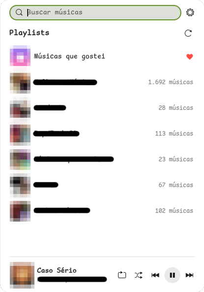
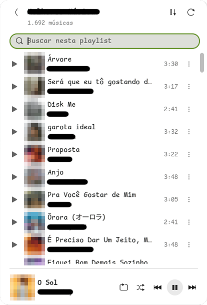

# ytmusic-panel

**English** | [Português (Brasil)](README.pt-BR.md)

[](https://github.com/jayanmoura/ytmusic-panel/actions/workflows/ci.yml)
[](LICENSE)
[](https://www.gnome.org/)

An unofficial YouTube Music player for the GNOME Shell top bar.

<p align="center">
  
  &nbsp;
  
</p>

> **Disclaimer:** this is an independent, unofficial project. It is not affiliated with, endorsed by or connected to Google or YouTube. "YouTube" and "YouTube Music" are trademarks of Google LLC. The project talks to YouTube Music's internal API through [ytmusicapi](https://github.com/sigma67/ytmusicapi) and [yt-dlp](https://github.com/yt-dlp/yt-dlp), and Google can change or block that access at any time. Use it at your own risk.

A GNOME Shell 50 extension that puts YouTube Music in the top bar. From its popup you can browse your playlists, play a playlist or a single song, search for songs, add songs to your playlists and control playback from a mini player or an expanded "now playing" view. Keyboard media keys and GNOME's media controls work too.

The interface is in Brazilian Portuguese; this README quotes its labels as they appear, with a translation in parentheses.

## How it works

There are two parts:

- **Extension** (`extension/`, UUID `ytmusic-panel@jayan`): only draws the interface. It never touches the network; it talks to the service over the session D-Bus, always asynchronously.
- **Service** (`daemon/`, `ytmusic-daemon`): a Python process running as a systemd user service. It uses [ytmusicapi](https://github.com/sigma67/ytmusicapi) for your account, `mpv` (audio only) for playback, `yt-dlp` to get the audio streams and the `mpv-mpris` plugin to expose the player over MPRIS.

The service owns `io.github.jayanmoura.YTMusic` on the session bus (object path `/io/github/jayanmoura/YTMusic`). Every method returns a JSON string: `{"ok": true, "data": ...}` or `{"ok": false, "error": "...", "message": "..."}`. All arguments are validated before anything else runs; invalid input gets `"error": "invalid_request"`.

## Requirements

- Ubuntu 26.04, or another distribution with GNOME Shell 50 (GNOME 50 only has a Wayland session)
- System packages: `mpv`, `mpv-mpris`, `python3-gi`, `python3-venv`

```bash
sudo apt install mpv mpv-mpris python3-gi python3-venv
```

Everything else (ytmusicapi, yt-dlp and the `deno` JavaScript runtime that yt-dlp needs for YouTube) goes into a dedicated virtual environment at `~/.local/share/ytmusic-daemon/venv`. Nothing is installed into the system Python.

## Installation

```bash
git clone https://github.com/jayanmoura/ytmusic-panel.git
cd ytmusic-panel
./install.sh
```

The script:

1. checks the system packages (if one is missing it prints the `apt` command and stops; it never runs `sudo`);
2. creates the virtual environment, installs the service and registers it with the systemd user instance (`~/.config/systemd/user/ytmusic-daemon.service`), started and enabled for your session;
3. installs the extension into `~/.local/share/gnome-shell/extensions/` and enables it, leaving your other extensions alone.

Then log in (next section) and **log out of your desktop session and back in**: on Wayland, GNOME Shell only picks up new extensions at login.

For development, use `./install.sh --dev`: the extension becomes a symlink to the `extension/` folder and the service is installed in editable mode.

## Logging in

The service reuses the YouTube session that is already open in your browser (its cookies), so there is nothing to copy and paste:

1. In your browser, open https://music.youtube.com and make sure you are signed in.
2. Open the extension preferences (the gear next to the search field, or `gnome-extensions prefs ytmusic-panel@jayan`).
3. Under **Conta e serviço** (account and service), pick your browser and click **Entrar com o navegador** (sign in with the browser).

Firefox (including the snap) and Chromium-based browsers (Chrome, Chromium, Brave, Edge, Vivaldi, Opera) are supported; only Firefox has been tested. Credentials are stored in `~/.config/ytmusic-daemon/browser.json` with mode 600 and never appear in the logs. The service checks the new session before replacing the credentials in use, so a failed login never breaks a working one.

**The session is shared with the browser.** If you sign out of YouTube in that browser, the extension is signed out too; to get back, sign in again in the browser and click **Entrar com o navegador**. While you stay signed in there, the service renews its access by itself whenever YouTube rejects the stored credentials. **Sair da conta neste app** (sign out of this app) deletes the credentials only from this computer and stops playback.

### Manual login (alternative)

This uses the headers of a request copied from the browser's developer tools. Run this **in your own terminal**:

```bash
~/.local/share/ytmusic-daemon/venv/bin/ytmusic-daemon-login
```

Then:

1. Open https://music.youtube.com signed in to your account.
2. Open the developer tools (F12), **Network** tab, and filter by `browse`.
3. Click **Biblioteca** (library) on the page to trigger a request.
4. Pick a **POST** request to `browse?...` with status 200. It must include the `Cookie` and `X-Goog-AuthUser` headers.
5. Copy the request headers:
   - Firefox: right click the request, **Copy Value**, **Copy Request Headers**.
   - Chrome: in the **Headers** tab, select the whole **Request Headers** block and copy it.
6. Paste into the terminal, press Enter, then **Ctrl+D**.

## Usage

Click the icon in the top bar.

- **Search**: the field at the top has focus when the popup opens; results show up when you stop typing (or press Enter). Inside a playlist the field moves below the playlist name and filters that playlist's songs instead (title, artist or album, ignoring accents).
- **Playlists**: "Músicas que gostei" (liked music) is always first. Click a playlist to see its songs.
- **Playlist order**: playlists open with the most recently added songs at the top. The button next to refresh flips the order to oldest first (it stays highlighted while active); reopening the playlist goes back to newest first. Playing from a song follows the order on screen.
- **Play**: a song's ▶ plays from that song and continues through the playlist. In search results it plays just that song.
- **Song menu** (⋮, inside a playlist; a floating menu that closes when you click outside it): add to the queue, play next, add to another playlist, share (copies the `music.youtube.com` link and shows "Link copiado") and remove from the playlist (only in your own playlists; asks for a second click to confirm). Removing from "Músicas que gostei" un-likes the song.
- **Add to a playlist**: in search results, the **+** button lists your playlists. Adding to "Músicas que gostei" likes the song.
- **Mini player** (bottom): repeat, shuffle, previous, play/pause and next. "Previous" more than 3 seconds into a song restarts it. Repeat cycles through off, repeat queue and repeat current song (icon with a "1"); shuffle shuffles the rest of the queue, and turning it off restores the original order. Both use the system accent color while on. Long titles scroll slowly so you can read them.
- **Expanded player**: click the cover or the song title in the mini player to open "Tocando agora" (now playing), laid out like the YouTube Music phone app: album name on top, a large cover, title and artist, the progress bar and, below it, the controls (shuffle, previous, play/pause, next, repeat). The mini player hides while this view is open. Click anywhere on the bar to seek. Click the mini player area or the back arrow to return.
- **Media keys** and GNOME's media controls (in the date and time menu) drive the same player, which shows up as `org.mpris.MediaPlayer2.mpv.ytmusic`.

### Preferences

```bash
gnome-extensions prefs ytmusic-panel@jayan
```

The window shows your account (photo, name and handle) at the top, then these sections:

- **Aparência** (appearance): popup theme (automatic, light or dark), popup height (fixed; it shrinks automatically if it doesn't fit the screen) and whether to show covers
- **Biblioteca** (library): show "Episódios para mais tarde" (saved podcast episodes; hidden by default)
- **Conta e serviço** (account and service): browser sign in, sign out, and the commands for manual login and logs

The gear next to the search field in the popup opens the same window.

## Logs and troubleshooting

```bash
journalctl --user -fu ytmusic-daemon                      # service
journalctl -f -o cat /usr/bin/gnome-shell | grep -i ytmusic # extension
systemctl --user status ytmusic-daemon
busctl --user call io.github.jayanmoura.YTMusic /io/github/jayanmoura/YTMusic io.github.jayanmoura.YTMusic GetStatus
```

### Common problems

- **"Você não está conectado"** (you are not signed in): check that you are signed in in the browser and click **Entrar com o navegador** in the preferences.
- **"O serviço ytmusic-daemon não está respondendo"** (the service is not responding): run `systemctl --user restart ytmusic-daemon` and check the journal.
- **A song doesn't play, or the journal says "track failed to play"**: YouTube changes its protections often. Update yt-dlp with `./scripts/install-daemon.sh` (it always installs the latest version) and restart the service.
- **Songs take a moment to start**: getting a song's audio takes about 2 to 4 seconds. To hide that, the service starts fetching the audio as soon as your pointer rests on a song, and fetches the next song in the queue while the current one plays; in those cases playback starts in under a second.

## Uninstalling

```bash
./uninstall.sh          # keeps your credentials
./uninstall.sh --purge  # also deletes credentials and the cover cache
```

## Development

Layout:

```
extension/                GNOME Shell extension (GJS, ES modules)
  extension.js            enable/disable: adds and removes the indicator
  indicator.js            panel button and popup: building it, navigating between
                          views, overlays and handing playback state to the player
  constants.js            special ids, timings and error texts
  util.js                 pure helpers (sorting playlists, formatting time, etc.)
  appearance.js           list height and light/dark theme
  covers.js               covers: queue and batched loading through the service
  ytmusicClient.js        asynchronous D-Bus client
  prefs.js                preferences (Adw)
  views/
    playlistsView.js      playlist list
    tracksView.js         playlist songs, filter, order and "show more"
    searchView.js         search
    pickerView.js         "add to playlist"
  player/
    controls.js           playback buttons and their state
    miniPlayer.js         mini player and scrolling title
    nowPlaying.js         expanded player and progress bar
  widgets/
    common.js             buttons, labels and ClipBox
    header.js             search row and header
    trackRow.js           song row and audio prefetch on hover
    floatMenu.js          floating menu (⋮) and song actions
    toast.js              short notices ("Link copiado")
daemon/ytmusic_daemon/    Python service
  service.py              D-Bus interface
  validation.py           argument validation for every D-Bus method
  client.py               ytmusicapi and caches
  player.py               mpv over IPC
  covers.py               on-disk cover cache
  login.py                ytmusic-daemon-login (manual login)
  browser_login.py        login with the browser's cookies
  resolver.py             resolves audio ahead of time (yt-dlp as a library)
  preload.lua             mpv script that uses the already resolved audio
scripts/
  install-daemon.sh       venv, package and systemd service
  dev-link.sh             links the extension into ~/.local/share and compiles the schema
  nested-shell.sh         nested shell for testing, with the service on its own bus
  check-interface.py      checks that the extension's D-Bus interface matches the service's
  check-calls.py          checks that indicator methods called by the modules exist
```

Modules in `views/`, `player/` and `widgets/` receive the indicator as a parameter and never import `indicator.js` (no circular imports). Every module that adds timeouts or connects signals has its own `destroy()`, called by the indicator.

Development loop:

- **Extension**: `./scripts/nested-shell.sh` opens a GNOME Shell in a window, with a copy of the service on that shell's own session bus. Close it and open it again to reload the code. Logs go to the terminal.
- **Service**: after editing, `systemctl --user restart ytmusic-daemon`.
- **D-Bus interface**: when you add or change a method, update `INTROSPECTION_XML` in `service.py`, `IFACE_XML` in `ytmusicClient.js` and `METHOD_ARGS` in `validation.py`.
- To test playback without sound, start the service with `YTMUSIC_MPV_EXTRA_ARGS=--ao=null`.

### Tests and lint

They also run on GitHub Actions for every push and pull request (`.github/workflows/ci.yml`).

Python (in the service's venv; the tools are the optional `[dev]` dependencies):

```bash
V=~/.local/share/ytmusic-daemon/venv/bin
$V/pip install -e "daemon[dev]"                          # pytest and ruff, once
$V/pytest daemon                                         # tests, no network and no mpv
$V/ruff check --config daemon/pyproject.toml daemon scripts
python3 scripts/check-interface.py                       # D-Bus interface matches on both sides
python3 scripts/check-calls.py                           # indicator methods called by the modules
```

The tests never touch your credentials: the XDG folders point to a temporary directory.

Extension (eslint, installed locally in `node_modules/`):

```bash
npm install          # once
npm run lint
```

### Design notes and known pitfalls

- yt-dlp uses YouTube's `web_music` client: stream URLs from the default client return 403 when mpv opens them.
- mpv's `--audio-client-name` must not contain spaces: mpv-mpris builds its D-Bus name from it, and an invalid name hangs mpv.
- Search uses ytmusicapi in English, because with language `pt` the songs filter comes back empty. Titles and artists are not translated, so nothing changes on screen.

## License

GPL-2.0-or-later. See [LICENSE](LICENSE).
