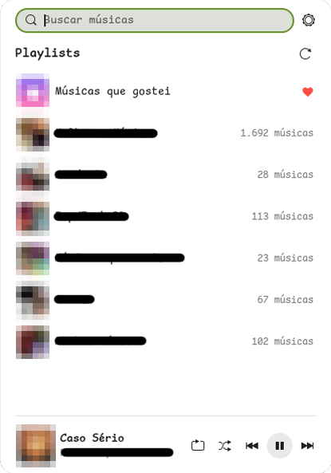
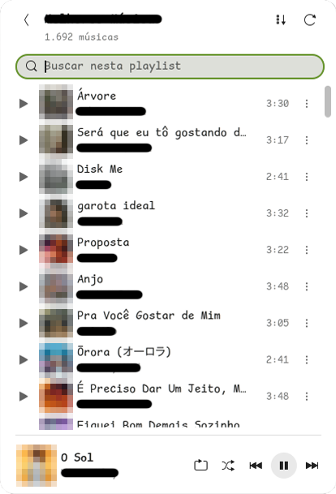

# ytmusic-panel

[English](README.md) | **Português (Brasil)**

[](https://github.com/jayanmoura/ytmusic-panel/actions/workflows/ci.yml)
[](LICENSE)
[](https://www.gnome.org/)

Player não oficial do YouTube Music para o painel do GNOME Shell.

<p align="center">
  
  &nbsp;
  
</p>

> **Aviso:** projeto independente e não oficial, sem nenhuma ligação com o Google ou o YouTube, nem endossado por eles. "YouTube" e "YouTube Music" são marcas do Google LLC. O projeto usa a API interna do YouTube Music por meio do [ytmusicapi](https://github.com/sigma67/ytmusicapi) e do [yt-dlp](https://github.com/yt-dlp/yt-dlp); o Google pode mudar ou bloquear esse acesso a qualquer momento. Use por sua conta e risco.

Extensão do GNOME Shell 50 que coloca o YouTube Music no painel superior. Pelo popup você vê suas playlists, abre e toca playlists ou músicas, busca músicas, adiciona músicas às suas playlists e controla a reprodução num mini player. As teclas de mídia do teclado e o controle de mídia do GNOME também funcionam.

## Como funciona

São duas partes:

- **Extensão** (`extension/`, UUID `ytmusic-panel@jayan`): só desenha a interface. Ela não acessa a rede; conversa com o serviço pelo D-Bus de sessão, sempre de forma assíncrona.
- **Serviço** (`daemon/`, `ytmusic-daemon`): processo Python que roda como serviço systemd de usuário. Usa o [ytmusicapi](https://github.com/sigma67/ytmusicapi) para falar com a sua conta, o `mpv` (só áudio) para tocar, o `yt-dlp` para obter o áudio e o plugin `mpv-mpris` para expor o player via MPRIS.

O serviço publica `io.github.jayanmoura.YTMusic` no barramento de sessão (caminho `/io/github/jayanmoura/YTMusic`). Todos os métodos devolvem JSON em texto: `{"ok": true, "data": ...}` ou `{"ok": false, "error": "...", "message": "..."}`. Os argumentos de todos os métodos são validados antes de qualquer outra coisa; entrada inválida recebe `"error": "invalid_request"`.

## Requisitos

- Ubuntu 26.04 (ou outra distribuição com GNOME Shell 50; o GNOME 50 só tem sessão Wayland)
- Pacotes do sistema: `mpv`, `mpv-mpris`, `python3-gi`, `python3-venv`

```bash
sudo apt install mpv mpv-mpris python3-gi python3-venv
```

O resto (ytmusicapi, yt-dlp e o runtime JavaScript `deno`, que o yt-dlp precisa para o YouTube) é instalado num ambiente virtual próprio em `~/.local/share/ytmusic-daemon/venv`. Nada é instalado com pip no Python do sistema.

## Instalação

```bash
git clone https://github.com/jayanmoura/ytmusic-panel.git
cd ytmusic-panel
./install.sh
```

O script:

1. confere os pacotes do sistema (se faltar algum, mostra o comando `apt` e para; ele nunca usa `sudo`);
2. cria o ambiente virtual, instala o serviço e o registra no systemd de usuário (`~/.config/systemd/user/ytmusic-daemon.service`), já iniciado e configurado para subir com a sessão;
3. instala a extensão em `~/.local/share/gnome-shell/extensions/` e a habilita, sem mexer nas suas outras extensões.

Depois faça o login (próxima seção) e **saia e entre de novo na sessão**. No Wayland a shell só reconhece extensões novas no login.

Para desenvolver, use `./install.sh --dev`: a extensão vira um link simbólico para a pasta `extension/` e o serviço é instalado em modo editável.

## Login

O serviço usa a sessão do YouTube que já está aberta no seu navegador (os cookies dele). Não precisa copiar nada:

1. No navegador, abra https://music.youtube.com e confira se está conectado na sua conta.
2. Abra as configurações da extensão (engrenagem ao lado da busca, ou `gnome-extensions prefs ytmusic-panel@jayan`).
3. Em **Conta e serviço**, escolha o navegador e clique em **Entrar com o navegador**.

Funciona com Firefox (inclusive o snap) e com os navegadores baseados no Chromium (Chrome, Chromium, Brave, Edge, Vivaldi, Opera); só o Firefox foi testado. As credenciais ficam em `~/.config/ytmusic-daemon/browser.json`, com permissão 600, e nunca aparecem nos logs. O serviço confere a sessão antes de trocar as credenciais em uso.

**A sessão é a mesma do navegador.** Se você sair da conta do YouTube naquele navegador, o app também é desconectado; para voltar, entre de novo no navegador e clique em **Entrar com o navegador**. Enquanto você estiver conectado lá, o serviço renova o acesso sozinho quando o YouTube recusar as credenciais. **Sair da conta neste app** apaga as credenciais só deste computador e para a música.

### Login manual (alternativa)

Copiando os cabeçalhos de uma requisição do navegador. Rode **num terminal seu**:

```bash
~/.local/share/ytmusic-daemon/venv/bin/ytmusic-daemon-login
```

E siga os passos:

1. Abra https://music.youtube.com logado na sua conta.
2. Abra as ferramentas de desenvolvedor (F12), aba **Rede** (Network), e filtre por `browse`.
3. Clique em **Biblioteca** na página para gerar uma requisição.
4. Escolha uma requisição **POST** para `browse?...` com status 200. Ela precisa ter os cabeçalhos `Cookie` e `X-Goog-AuthUser`.
5. Copie os cabeçalhos da requisição:
   - Firefox: botão direito na requisição, **Copiar valor**, **Copiar cabeçalhos da requisição**.
   - Chrome: aba **Headers**, selecione todo o bloco **Request Headers** e copie.
6. Cole no terminal, aperte Enter e depois **Ctrl+D**.

## Uso

Clique no ícone no painel.

- **Busca**: o campo no topo já recebe o foco; os resultados aparecem quando você para de digitar (ou com Enter). Dentro de uma playlist, o campo fica abaixo do nome dela e filtra só as músicas da playlist (título, artista ou álbum, sem diferenciar acentos).
- **Playlists**: "Músicas que gostei" fica sempre no topo. Clique numa playlist para ver as músicas.
- **Ordem da playlist**: ela abre com as músicas adicionadas mais recentemente no topo. O botão ao lado de atualizar inverte para as mais antigas primeiro (fica destacado enquanto ativo); ao abrir a playlist de novo, volta para as mais recentes. Tocar a partir de uma música segue a ordem que está na tela.
- **Tocar**: o ▶ de uma música toca a partir dela e segue a playlist. Num resultado de busca, toca só aquela música.
- **Menu de uma música** (⋮, dentro de uma playlist; abre um menu flutuante, que fecha ao clicar fora): adicionar à fila, tocar a seguir, adicionar a outra playlist, compartilhar (copia o link `music.youtube.com` e mostra "Link copiado") e remover da playlist (só nas suas playlists; pede um segundo clique para confirmar). Remover de "Músicas que gostei" equivale a descurtir.
- **Adicionar a uma playlist**: nos resultados da busca, o botão **+** abre a lista das suas playlists. Adicionar a "Músicas que gostei" equivale a curtir a música.
- **Mini player** (rodapé): repetir, aleatório, anterior, play/pause e próxima. "Anterior" com mais de 3 segundos de música volta ao começo dela. Repetir alterna entre desligado, repetir a fila e repetir a música atual (ícone com "1"); aleatório embaralha o resto da fila, e desligar volta à ordem original. Quando ligados, os dois ficam na cor de destaque do sistema. Títulos longos rolam devagar para mostrar o nome inteiro.
- **Player expandido**: clique na capa ou no nome da música, no mini player, para abrir a tela "Tocando agora", no estilo do app do YouTube Music para celular: o álbum em cima, a capa grande, o nome e o artista, a barra de progresso e, embaixo dela, os controles (aleatório, anterior, play/pause, próxima, repetir). O mini player some enquanto essa tela está aberta. Clique em qualquer ponto da barra para ir até ali. Clique de novo no mini player ou na seta para voltar.
- **Teclas de mídia** e o controle de mídia do GNOME (menu de data e hora) controlam o mesmo player, que aparece como `org.mpris.MediaPlayer2.mpv.ytmusic`.

### Preferências

```bash
gnome-extensions prefs ytmusic-panel@jayan
```

A janela mostra a sua conta (foto, nome e @) no topo e, abaixo, as seções:

- **Aparência**: tema do popup (automático, claro ou escuro), altura do popup (fixa; se não couber na tela, diminui sozinha) e mostrar capas
- **Biblioteca**: mostrar "Episódios para mais tarde" (lista de podcasts salvos; escondida por padrão)
- **Conta e serviço**: entrar com o navegador, sair da conta e os comandos de login manual e de logs

A engrenagem ao lado da busca, no popup, abre a mesma janela.

## Logs e diagnóstico

```bash
journalctl --user -fu ytmusic-daemon                      # serviço
journalctl -f -o cat /usr/bin/gnome-shell | grep -i ytmusic # extensão
systemctl --user status ytmusic-daemon
busctl --user call io.github.jayanmoura.YTMusic /io/github/jayanmoura/YTMusic io.github.jayanmoura.YTMusic GetStatus
```

### Problemas comuns

- **"Você não está conectado"**: confira se está conectado no navegador e clique em **Entrar com o navegador** nas configurações.
- **"O serviço ytmusic-daemon não está respondendo"**: `systemctl --user restart ytmusic-daemon` e veja o journal.
- **A música não toca, ou o journal mostra "track failed to play"**: o YouTube muda as proteções com frequência. Atualize o yt-dlp com `./scripts/install-daemon.sh` (ele sempre instala a versão mais nova) e reinicie o serviço.
- **Demora para começar a tocar**: obter o áudio de uma música leva cerca de 2 a 4 segundos. Para esconder isso, o serviço começa a buscar o áudio quando você para o mouse sobre uma música, e busca a próxima da fila enquanto a atual toca; nesses casos ela começa em menos de 1 segundo.

## Desinstalação

```bash
./uninstall.sh          # mantém as credenciais
./uninstall.sh --purge  # apaga também credenciais e cache de capas
```

## Desenvolvimento

Estrutura:

```
extension/                extensão GNOME Shell (GJS, módulos ES)
  extension.js            enable/disable: adiciona e remove o indicador
  indicator.js            botão do painel e popup: montagem, navegação entre as
                          telas, sobreposições e distribuição do estado da reprodução
  constants.js            IDs especiais, tempos e textos de erro
  util.js                 funções puras (ordenar playlists, formatar tempo etc.)
  appearance.js           altura da lista e tema claro/escuro
  covers.js               capas: fila e carregamento em lote pelo serviço
  ytmusicClient.js        cliente D-Bus assíncrono
  prefs.js                preferências (Adw)
  views/
    playlistsView.js      lista de playlists
    tracksView.js         músicas da playlist, filtro, ordem e "mostrar mais"
    searchView.js         busca
    pickerView.js         "Adicionar a playlist"
  player/
    controls.js           botões de reprodução e o estado deles
    miniPlayer.js         mini player e título rolando
    nowPlaying.js         player expandido e barra de progresso
  widgets/
    common.js             botões, rótulos e ClipBox
    header.js             linha de busca e cabeçalho
    trackRow.js           linha de música e pré-carga ao passar o mouse
    floatMenu.js          menu flutuante (⋮) e as ações da música
    toast.js              avisos curtos ("Link copiado")
daemon/ytmusic_daemon/    serviço Python
  service.py              interface D-Bus
  validation.py           validação dos argumentos de todos os métodos D-Bus
  client.py               ytmusicapi, caches
  player.py               mpv via IPC
  covers.py               cache de capas em disco
  login.py                ytmusic-daemon-login (login manual)
  browser_login.py        login com os cookies do navegador
  resolver.py             obtém o áudio com antecedência (yt-dlp como biblioteca)
  preload.lua             script do mpv que usa o áudio já obtido
scripts/
  install-daemon.sh       venv, pacote e serviço systemd
  dev-link.sh             liga a extensão a ~/.local/share e compila o schema
  nested-shell.sh         shell aninhada para testes, com o serviço no barramento dela
  check-interface.py      confere se a interface D-Bus da extensão bate com a do serviço
  check-calls.py          confere se os métodos do indicador chamados pelos módulos existem
```

Os módulos de `views/`, `player/` e `widgets/` recebem o indicador como parâmetro e nunca importam o `indicator.js` (sem importação circular). Cada módulo que cria timeouts ou conecta sinais tem o próprio `destroy()`, chamado pelo indicador.

Ciclo de desenvolvimento:

- **Extensão**: `./scripts/nested-shell.sh` abre uma GNOME Shell numa janela, com uma cópia do serviço no barramento isolado dela. Feche e abra de novo para recarregar o código. Os logs saem no terminal.
- **Serviço**: depois de editar, `systemctl --user restart ytmusic-daemon`.
- **Interface D-Bus**: ao adicionar ou mudar um método, atualize `INTROSPECTION_XML` em `service.py`, `IFACE_XML` em `ytmusicClient.js` e `METHOD_ARGS` em `validation.py`.
- Para testar a reprodução sem som, inicie o serviço com `YTMUSIC_MPV_EXTRA_ARGS=--ao=null`.

### Testes e lint

Rodam também no GitHub Actions a cada push e pull request (`.github/workflows/ci.yml`).

Python (no venv do serviço; as ferramentas são dependências opcionais `[dev]`):

```bash
V=~/.local/share/ytmusic-daemon/venv/bin
$V/pip install -e "daemon[dev]"                          # pytest e ruff, uma vez
$V/pytest daemon                                         # testes, sem rede e sem mpv
$V/ruff check --config daemon/pyproject.toml daemon scripts
python3 scripts/check-interface.py                       # interface D-Bus igual nos dois lados
python3 scripts/check-calls.py                           # métodos do indicador chamados pelos módulos
```

Os testes não tocam nas suas credenciais: as pastas XDG apontam para um diretório temporário.

Extensão (eslint, instalado localmente em `node_modules/`):

```bash
npm install          # uma vez
npm run lint
```

### Decisões e armadilhas conhecidas

- O yt-dlp usa o cliente `web_music` do YouTube: as URLs do cliente padrão retornam 403 quando abertas pelo mpv.
- `--audio-client-name` do mpv não pode ter espaço: o mpv-mpris usa esse valor no nome D-Bus, e um nome inválido trava o mpv.
- A busca usa o ytmusicapi em inglês, porque com idioma `pt` o filtro de músicas volta vazio. Títulos e artistas não são traduzidos, então nada muda na tela.

## Licença

GPL-2.0-or-later. Veja o arquivo [LICENSE](LICENSE).
